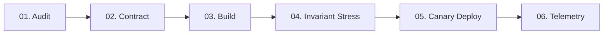

# ENOMOTIA

<div align="center">

```text
███████╗███╗   ██╗ ██████╗ ███╗   ███╗ ██████╗ ████████╗██╗ █████╗ 
██╔════╝████╗  ██║██╔═══██╗████╗ ████║██╔═══██╗╚══██╔══╝██║██╔══██╗
█████╗  ██╔██╗ ██║██║   ██║██╔████╔██║██║   ██║   ██║   ██║███████║
██╔══╝  ██║╚██╗██║██║   ██║██║╚██╔╝██║██║   ██║   ██║   ██║██╔══██║
███████╗██║ ╚████║╚██████╔╝██║ ╚═╝ ██║╚██████╔╝   ██║   ██║██║  ██║
╚══════╝╚═╝  ╚═══╝ ╚═════╝ ╚═╝     ╚═╝ ╚═════╝    ╚═╝   ╚═╝╚═╝  ╚═╝
```

### Deterministic Software Engineering & Founder-Led Systems Collective

[](https://enomotiatech.com)
[](https://enomotiatech.com)
[](https://enomotiatech.com)
[](https://enomotiatech.com)
[](https://enomotiatech.com)

**WE ENGINEER, NEVER ASSUME.**

[Website](https://enomotiatech.com) • [The Creed](the%20creed.md) • [About Us](about.md) • [Legal & Policies](policies/policies.md) • [Contact](mailto:contact@enomotiatech.com)

</div>

---

## ⚡ Who We Are

**ENOMOTIA** is a founder-led engineering collective forged to eradicate technical fragility. We are deep-stack systems architects, distributed cloud engineers, and autonomous AI developers who treat code not as disposable commodity work, but as high-stakes infrastructure.

Our name is drawn directly from the ancient Spartan *enomotia* (ἐνωμοτία)—an elite sworn brotherhood of 32 to 36 peers bound by solemn oath. In the Spartan phalanx, every warrior’s bronze shield (*aspis*) covered his own left flank while directly protecting the exposed right side of the brother standing beside him.

We bring that exact level of unbreakable mutual accountability to modern software engineering. When you engage Enomotia, every person on your architecture is a hands-on builder who takes complete personal ownership from day one—no account managers, no sales intermediaries, and no delegation downstream.

---

## 🏛️ Core Engineering Invariants

| Principle | Operational Invariant | Standard |
| :--- | :--- | :--- |
| **Zero Assumptions** | Empirical verification over hopeful speculation | Every interface, payload, and concurrency ceiling is proven under synthetic stress tests. |
| **Codebase Integrity** | Zero dirty reads & zero race conditions | All state mutations are validated against formal invariant boundaries before hitting production. |
| **Autonomous Runtime** | Self-healing background daemons | Mission-critical event loops execute silently in the dark with automated rollback gates. |
| **Throughput Engine** | Kernel-level eBPF & zero-allocation IO | Bottlenecks are profiled and drained before backpressure cascades into user queues. |
| **Direct Access** | 100% Founder & Builder access | You speak and plan directly with the engineers architecting, writing, and debugging your code. |

---

## 🛠️ Specialized Services Directory

ENOMOTIA operates across 11 core engineering disciplines:

### 1. [AI Automations](https://enomotiatech.com/ai-automations) — `Self-Healing Agentic Pipelines & LLM Daemons`
Deterministic automation routines and autonomous agent swarms that replace fragile manual glue code with hardened, observable workflows.
- **Key Deliverables:** Autonomous tool-calling agents (strict Pydantic schema enforcement), hybrid BM25 + dense vector RAG ingestion, real-time token tracing, and self-correcting retry daemons.
- **Benchmarks:** `99.9%` Output Determinism • `< 420ms` P95 Latency • `88%` Manual Toil Eliminated.

### 2. [AI Ops](https://enomotiatech.com/ai-ops) — `Autonomous Model Telemetry & Continuous Evaluation`
Enterprise AI operations infrastructure providing real-time drift detection, automated fine-tuning loops, and cost-optimized GPU inference clusters.
- **Key Deliverables:** Embedding & semantic drift monitoring, dynamic tiered token routing (small open models vs frontier LLMs), continuous LoRA fine-tuning pipelines, and TensorRT-LLM/vLLM cluster tuning.
- **Benchmarks:** `< 180ms` Inference P99 • `Real-Time` Drift Detection • `+46%` GPU Yield Increase.

### 3. [Quality Assurance](https://enomotiatech.com/quality-assurance) — `Autonomous Verification & Relentless Stress Testing`
End-to-end automated test harnesses that hunt edge-case failures, race conditions, and regressions before code ever approaches production.
- **Key Deliverables:** Parallelized Playwright/Cypress test harnesses sharded across CI runners, property-based invariant fuzzing, pixel-diffing visual regression daemons, and synthetic multi-region load injection.
- **Benchmarks:** `0.00%` Flake Failure Rate • `< 2.4 min` Sharded Pipeline • `> 95%` Branch Coverage.

### 4. [DevSecOps](https://enomotiatech.com/devsecops) — `Continuous Delivery & Shift-Left Hardening`
Unified DevSecOps engineering combining automated CI/CD security gates, immutable cloud infrastructure, and real-time threat containment.
- **Key Deliverables:** Automated SAST/DAST scanning, ephemeral secret rotation via HashiCorp Vault, declarative GitOps cluster synchronization (ArgoCD/Flux), gVisor/Firecracker microVM sandboxing, and automated canary rollbacks.
- **Benchmarks:** `< 2 hrs` Vulnerability MTTR • `99.99%` Production Uptime • `0.00%` Configuration Drift.

### 5. [Networking](https://enomotiatech.com/networking) — `Low-Latency Zero-Trust Infrastructure & Mesh Fabrics`
Distributed network topologies designed for sub-millisecond edge routing, eBPF telemetry, and wire-speed packet filtering.
- **Key Deliverables:** WireGuard and Tailscale zero-trust overlay meshes, kernel-level eBPF socket tracing, global Anycast BGP routing, and edge sliding-window rate-limiting shields.
- **Benchmarks:** `< 1.8ms` Inter-Node Latency • `0.001%` Packet Drop Rate • `500+ Gbps` DDoS Capacity.

### 6. [Embedded Systems](https://enomotiatech.com/embedded-systems) — `Bare-Metal Firmware, RTOS & Low-Power Hardware`
Deterministic embedded software engineered for microcontrollers, industrial sensors, and mission-critical hardware.
- **Key Deliverables:** FreeRTOS and Zephyr deterministic scheduling, memory-safe embedded Rust firmware, cryptographically signed dual-bank A/B OTA bootloaders, and ultra-low-power sleep optimization.
- **Benchmarks:** `< 64 KB` Firmware Footprint • `< 15ms` Cold Boot Time • `0.00%` Field Brick Rate.

### 7. [Brand Identity](https://enomotiatech.com/brand-identity) — `Technical Identity, Type Design & Design Systems`
High-contrast visual architectures for deep-tech, robotics, and engineering brands that demand uncompromising mathematical clarity.
- **Key Deliverables:** Living component token systems (Figma to Tailwind/CSS variables), mathematical typography scales, airtight dark/light OLED theme matrices, and zero-ambiguity brand guidelines.
- **Benchmarks:** `100%` Token Adherence • `WCAG AAA` Contrast • `42%` Asset Weight Saved.

### 8. [UI/UX Design](https://enomotiatech.com/ui-ux-design) — `Ergonomic Workbenches & High-Density Dashboards`
High-density interfaces, developer tooling consoles, and mission-critical workflows engineered for zero cognitive fatigue and maximum velocity.
- **Key Deliverables:** Keyboard-first developer control consoles, deterministic interactive token states, subtle cubic-bezier micro-interactions, and usability stress testing under synthetic operational pressure.
- **Benchmarks:** `99.4%` Task Completion Rate • `< 1.2s` Time to First Action • `-45%` Cognitive Load.

### 9. [Web Applications](https://enomotiatech.com/web-applications) — `High-Throughput Web Platforms & Real-Time Streams`
Modern enterprise web applications built with micro-frontend architectures, real-time WebSockets, sub-second page loads, and bulletproof client caching.
- **Key Deliverables:** Edge-rendered distributed frontends, multiplexed bidirectional WebSockets at 60fps, optimistic state reconciliation with rollback safety, and progressive offline-first web architectures.
- **Benchmarks:** `100/100` Lighthouse Score • `< 85ms` TTFB • `0` Hydration Mismatches.

### 10. [App Development](https://enomotiatech.com/app-development) — `Native iOS & Android, Cross-Platform Architecture`
Mission-critical mobile and web applications engineered with reactive state management, 60fps micro-interactions, offline-first sync, and unbreakable backends.
- **Key Deliverables:** Native Swift and Kotlin architectures, Flutter/React Native cross-platform systems with custom bridges, local SQLite/CRDT offline synchronization, and end-to-end type-safe APIs.
- **Benchmarks:** `60 fps` Fluid Frame Rate • `< 450ms` Cold Start • `99.98%` Crash-Free Sessions.

### 11. [Cloud Architecture](https://enomotiatech.com/cloud-architecture) — `Multi-Region Topologies & Resilient Cloud Foundations`
Enterprise cloud infrastructure across AWS, GCP, Azure, and bare-metal environments built for multi-region failover, elastic autoscaling, and zero single points of failure.
- **Key Deliverables:** Multi-region active-active topologies with BGP Anycast routing, 100% declarative IaC (Terraform/OpenTofu), automated chaos drills, and distributed consensus database replication (CockroachDB, Raft).
- **Benchmarks:** `99.999%` Production Uptime • `< 60s` RPO/RTO • `-38%` Cloud Spend Optimized.

---

## 💻 Technology Stack & Infrastructure

```text
┌─────────────────────────────────────────────────────────────────────────────┐
│                          ENOMOTIA TECHNOLOGY MATRIX                         │
├───────────────────────┬─────────────────────────────────────────────────────┤
│ Cloud & Orchestration │ AWS, GCP, Azure, Equinix Metal, Kubernetes, Docker, │
│                       │ OpenTofu, Terraform, ArgoCD, Flux v2, Helm          │
├───────────────────────┼─────────────────────────────────────────────────────┤
│ Autonomous AI & ML    │ OpenAI, Anthropic Claude, Gemini, LangChain, vLLM,  │
│                       │ TensorRT-LLM, LlamaIndex, Qdrant, Pinecone, LoRA    │
├───────────────────────┼─────────────────────────────────────────────────────┤
│ Systems & Languages   │ Rust, TypeScript, Python, Go, C/C++, Swift, Kotlin  │
├───────────────────────┼─────────────────────────────────────────────────────┤
│ Platform & Web        │ React 18, Vite 6, Next.js, Node.js, Tailwind CSS 3, │
│                       │ tRPC, GraphQL, Protobuf, WebSockets, CRDTs          │
├───────────────────────┼─────────────────────────────────────────────────────┤
│ Security & Defense    │ HashiCorp Vault, gVisor, Firecracker, WireGuard,     │
│                       │ Tailscale, eBPF, Open Policy Agent, Trivy, Cosign   │
├───────────────────────┼─────────────────────────────────────────────────────┤
│ Embedded & Firmware   │ FreeRTOS, Zephyr RTOS, ARM Cortex, ESP32, STM32,    │
│                       │ RISC-V, Embedded Rust, QEMU, I2C, SPI, CAN bus      │
├───────────────────────┼─────────────────────────────────────────────────────┤
│ Databases & Storage   │ PostgreSQL, CockroachDB, Redis, SQLite, ClickHouse, │
│                       │ MinIO, S3-compatible object storage                 │
└───────────────────────┴─────────────────────────────────────────────────────┘
```

---

## 🔄 The Flow of Work (6 Phased Lifecycle)

Every project we undertake progresses through six deterministic gates:



1. **Phase 01 — Architectural Audit & Discovery:** We audit existing repositories, cloud topology, and operational friction points to establish empirical benchmarks before writing code.
2. **Phase 02 — Formal Contract & Specification:** We define strict API contracts, data schemas, and runtime performance budgets to eliminate ambiguity.
3. **Phase 03 — Deterministic Iterative Sprint:** Modular, type-safe code delivered in observable increments with continuous automated linting and unit validation.
4. **Phase 04 — Stress Ingestion & Invariant Verification:** Synthetic traffic injection, property-based boundary testing, and visual regression sweeps hunting edge-case failures.
5. **Phase 05 — Hardened Production Deployment:** Canary releases with automated health rollback gates, immutable container images, and zero downtime.
6. **Phase 06 — Continuous Telemetry & Adaptation:** Real-time eBPF metrics, latency profiling, and automated drift alerts ensuring systems hold under evolving scale.

---

## 📜 The Spartan Phalanx & The Creed

Our culture is rooted in ancient Spartan operational doctrine:
- **The Rhythm of the Flutes:** We advance with calm, measured precision over frantic panic. We reject midnight fire drills and chaotic rush jobs in favor of deterministic engineering.
- **The Overlapping Shield:** We build sovereign, resilient systems with decoupled architectures and declarative IaC. Systemic resilience triumphs over individual heroics.
- **The Spartan Phalanx:** We remain compact, elite, and focused. When you engage Enomotia, you receive seasoned practitioners who move faster and build cleaner than an agency of fifty developers.
- **The Unyielding Standard:** Code quality is an absolute moral constraint. We do not ship dirty reads or half-tested logic to meet artificial deadlines.

> *"The code no client will ever read is the truest test of your craft."*  
> — The Standard of Unwitnessed Work (✓ In Craft & Discipline)

Read the full text in [the creed.md]([the%20creed.md](https://github.com/ENOMOTIA-TECH/Enomotia/blob/main/The%20Creed.md).

---

## ⚖️ Legal & Compliance Transparency

- **Terms and Conditions:** [policies/terms.md](https://github.com/ENOMOTIA-TECH/Policies/blob/main/Terms.md)
- **Privacy & Cookie Policies:** [[policies/policies.md](policies/policies.md](https://github.com/ENOMOTIA-TECH/Policies/blob/main/Terms.md))
- **Standalone Privacy Policy:** [policies/privacy.md]([policies/privacy.md](https://github.com/ENOMOTIA-TECH/Policies/blob/main/Privacy.md))
- **Standalone Cookie Policy:** [policies/cookies.md]([policies/cookies.md](https://github.com/ENOMOTIA-TECH/Policies/blob/main/Cookies.md))

---

## 📡 Dispatch & Contact Channels

Whether you need to architect fault-tolerant multi-region topologies, deploy self-healing autonomous AI pipelines, or audit a mission-critical codebase, work directly with our engineering team:

- **Official Website:** [https://enomotiatech.com](https://enomotiatech.com)
- **Direct Engineering Inquiries:** [contact@enomotiatech.com](mailto:contact@enomotiatech.com)
- **Headquarters / Registered Office:**  
  ENOMOTIA  
  14/160, Divine Cottage, Kurumpanai, Killiyoor,  
  Colachel, Kanyakumari, Tamil Nadu, India, 629251  
- **Grievance Officer:** Joji John (Proprietor)
- **Response Commitment:** Telemetry acknowledged within 24–48 hours.

<div align="center">

```text
WE ENGINEER, NEVER ASSUME.
© 2026 ENOMOTIA. ALL RIGHTS RESERVED.
```

</div>
